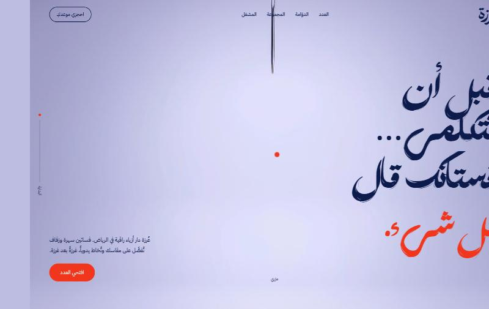
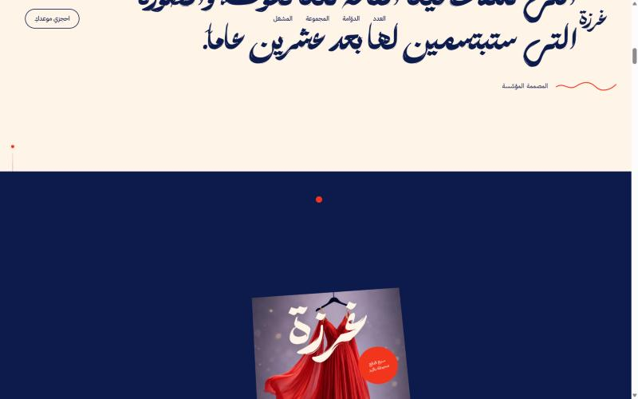
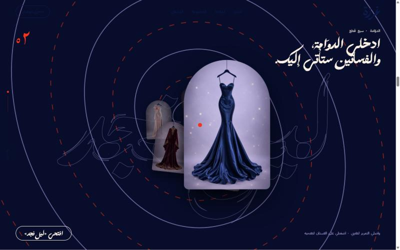
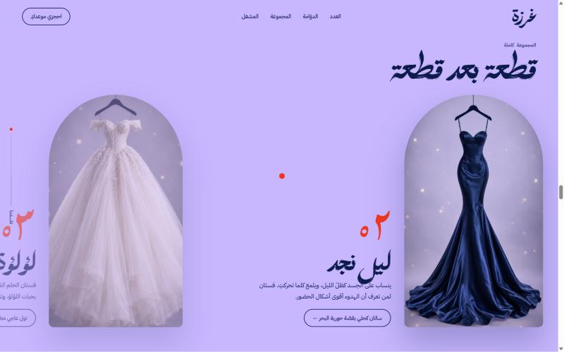
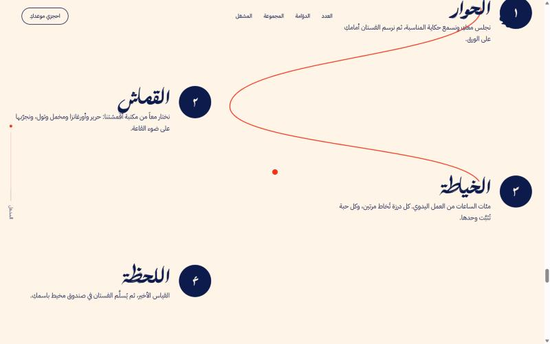
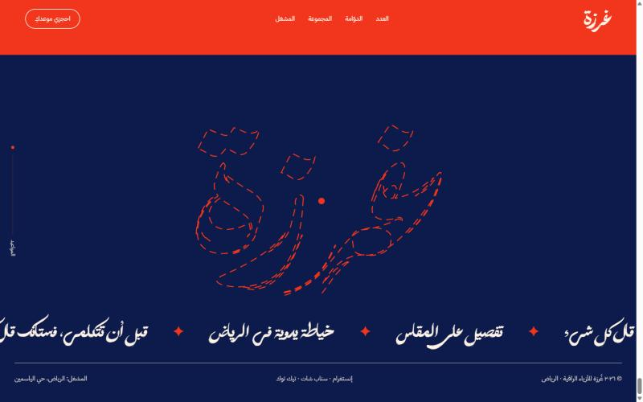
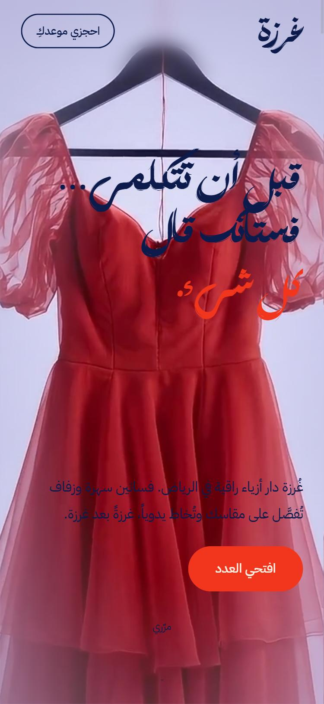
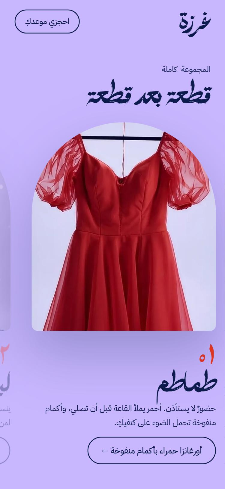
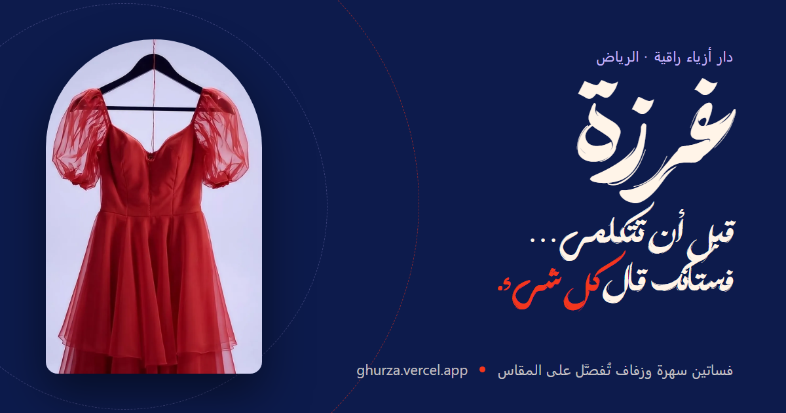

<div align="center">

# غُرزة — Ghurza Couture

**دار أزياء راقية في الرياض · فساتين سهرة وزفاف تُفصَّل على المقاس وتُخاط يدوياً**

[](https://ghurza.vercel.app)

📍 المشغل: الرياض، حي الياسمين



</div>

---

## عن الموقع

موقع دار **غُرزة** مصمم كمجلة أزياء تتصفحها بالتمرير — كل قسم صفحة تنفتح من حافة مختلفة فوق التي قبلها، مع معرض فساتين تفاعلي يفتح كل فستان بتفاصيله وقماشه وقصته.

## لقطات من الموقع

| غلاف العدد | الدوّامة |
| :---: | :---: |
|  |  |
| **المجموعة** | **المشغل** |
|  |  |

<div align="center">

</div>

### على الجوال

<div align="center">

&nbsp;&nbsp;

</div>

### صورة المشاركة

هذه الصورة تظهر عند مشاركة الرابط في واتساب وتويتر وغيرها:

<div align="center">

</div>

## المميزات

- واجهة عربية بالكامل (RTL) بخط عرض مخصص
- فيديو افتتاحي بنسختين (سطح المكتب والجوال)
- تمرير سلس وحركات مرتبطة بالتمرير
- «الدوّامة»: نفق تفاعلي تقترب فيه الفساتين كلما مرّرت
- معرض لستة فساتين: طماطم، ليل نجد، لؤلؤة، سدو، همس، مطر
- قسم المشغل يشرح رحلة الفستان: الحوار، القماش، الخياطة، اللحظة
- صور WebP بحجمين للتحميل السريع
- متجاوب مع جميع الشاشات
- أيقونة للتبويب والجوال، وصورة معاينة عند مشاركة الرابط (Open Graph)

## التقنيات

| الأداة | الاستخدام |
| --- | --- |
| HTML / CSS / JavaScript | بدون أي build أو إطار عمل |
| [GSAP](https://gsap.com) + ScrollTrigger | الحركات المرتبطة بالتمرير |
| [Lenis](https://lenis.darkroom.engineering) | التمرير السلس |
| IBM Plex Sans Arabic | خط النصوص |
| [Vercel](https://vercel.com) | الاستضافة |

## هيكل المشروع

```
.
├── index.html      # الصفحة كاملة (HTML + CSS + JS)
├── assets/         # الصور، الفيديو، والخط
├── libs/           # GSAP و ScrollTrigger و Lenis
└── screenshots/    # لقطات README
```

## التشغيل محلياً

الموقع ملفات ثابتة، يكفي أي سيرفر محلي:

```bash
npx serve .
```

ثم افتح http://localhost:3000

## النشر

مستضاف على Vercel: **https://ghurza.vercel.app**

---

<div align="center">

© ٢٠٢٦ غُرزة للأزياء الراقية · الرياض

</div>
